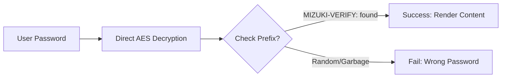

本文演示浏览器端的密码保护。密码是故意放在仓库里的，方便读者打开这个示例；不要把它用在任何真正私密的内容上。

## 文章 frontmatter

```yaml
---
title: My First Blog Post
published: 2023-09-09
description: This is the first post of my new Astro blog.
image: ./cover.jpg
tags: [Foo, Bar]
category: Front-end
draft: false
---
```

| 字段          | 说明 |
|---------------|------|
| `title`       | 文章标题。 |
| `published`   | 文章发布日期。 |
| `pinned`      | 是否置顶到文章列表顶部。 |
| `description` | 文章简短描述，显示在列表页。 |
| `image`       | 文章封面路径。<br/>1. 以 `http://` 或 `https://` 开头：使用网络图片<br/>2. 以 `/` 开头：使用 `public` 目录下的图片<br/>3. 都不带：相对 Markdown 文件所在目录 |
| `tags`        | 文章标签。 |
| `category`    | 文章分类。 |
| `alias`       | 文章别名。设置后文章可通过 `/posts/{alias}/` 访问。例如 `my-special-article`（地址为 `/posts/my-special-article/`）。 |
| `licenseName` | 文章内容的许可协议名称。 |
| `author`      | 文章作者。 |
| `sourceLink`  | 文章内容的来源或参考链接。 |
| `draft`       | 若为草稿则不显示。 |
| `encrypted`   | 是否为密码保护文章。 |
| `password`    | 解锁加密文章的口令。 |
| `passwordHint`| 帮助读者回忆口令的提示，显示在口令输入框下方。 |
| `hideHomeContent` | 是否隐藏公开摘要，包括首页、meta 标签、feed/API 摘要和分享预览。设置了 `password` 时默认为 `true`。 |

## 文章文件放在哪

文章文件应放在 `src/content/posts/` 目录下。也可以建子目录，更好地归类文章和资源。

```
src/content/posts/
├── post-1.md
└── post-2/
    ├── cover.png
    └── index.md
```

## 文章别名

给 frontmatter 加上 `alias` 字段，就能给任意文章设置别名：

```yaml
---
title: My Special Article
published: 2024-01-15
alias: "my-special-article"
tags: ["Example"]
category: "Technology"
---
```

设置别名后：

- 文章可通过自定义地址访问（例如 `/posts/my-special-article/`）
- 默认的 `/posts/{slug}/` 地址依然可用
- RSS/Atom 订阅使用自定义别名
- 站内所有链接自动使用自定义别名

**注意事项：**

- 别名里不要带 `/posts/` 前缀（会自动补上）
- 别名里避免特殊字符和空格
- 为了搜索引擎友好，用小写字母和连字符
- 确保所有文章的别名互不重复
- 不要在首尾加斜杠

## 工作原理



## 页面加密

在 frontmatter 里设置 `encrypted: true` 并提供 `password`，就能给任意文章加密码：

```yaml
---
title: My Private Post
published: 2024-01-15
encrypted: true
password: "my-secret-password"
passwordHint: "Hint: The password is my dog's name"
hideHomeContent: true
---
```

### 字段说明

| 字段 | 是否必填 | 说明 |
|------|----------|------|
| `encrypted`    | 是 | 设为 `true` 开启密码保护 |
| `password`     | 是 | 解锁文章的口令 |
| `passwordHint` | 否 | 显示在口令输入框下方，帮读者回忆 |
| `hideHomeContent` | 否 | 隐藏公开摘要，对外显示为 `该文章已加密`。设置 `password` 时默认为 `true`，设为 `false` 可显示正常摘要。 |

### 解锁框长什么样

解锁框会显示：

- 主题主色调的锁形图标
- 标题「密码保护」
- 一段提示输入口令的说明
- 口令提示（如果提供了 `passwordHint`）
- 口令输入框和解锁按钮

输入正确口令后，内容会被解密并显示。口令会存进 session storage（会话存储），同一次会话内后续刷新无需重新输入。
