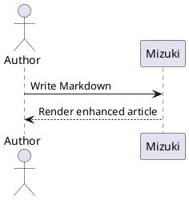
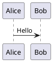

## GitHub 仓库卡片
可以插入链接到 GitHub 仓库的动态卡片，页面加载时会从 GitHub API 拉取仓库信息。

::github{repo="LyraVoid/Mizuki"}

用 `::github{repo="LyraVoid/Mizuki"}` 这段代码就能生成一张 GitHub 仓库卡片。

```markdown
::github{repo="LyraVoid/Mizuki"}
```

## 提示块（Admonitions）

支持以下类型：`note` `tip` `important` `warning` `caution`

:::note
强调用户即使只是扫一眼也该注意的信息。
:::

:::tip
帮助用户更顺利完成事情的补充信息。
:::

:::important
用户要成功所必需的关键信息。
:::

:::warning
因存在潜在风险而需要用户立即注意的内容。
:::

:::caution
某个操作可能带来的负面后果。
:::

### 基本语法

```markdown
:::note
强调用户即使只是扫一眼也该注意的信息。
:::

:::tip
帮助用户更顺利完成事情的补充信息。
:::
```

### 自定义标题

提示块的标题可以自定义。

:::note[我的自定义标题]
这是一条使用自定义标题的提示。
:::

```markdown
:::note[我的自定义标题]
这是一条使用自定义标题的提示。
:::
```

### GitHub 写法

> [!TIP]
> 也支持 [GitHub 的提示写法](https://github.com/orgs/community/discussions/16925)。

```
> [!NOTE]
> The GitHub syntax is also supported.

> [!TIP]
> The GitHub syntax is also supported.
```

### 遮罩（Spoiler）

可以给文字加遮罩，遮罩内容同样支持 **Markdown** 语法。

内容 :spoiler[被藏起来了 **嘿嘿**]！

```markdown
内容 :spoiler[被藏起来了 **嘿嘿**]！
```

## 代码组

用 VitePress 风格的 `::: code-group labels=[...]` 语法，把几段相关示例做成可切换的标签页。标签页支持鼠标操作，也支持键盘的 <kbd>Left</kbd>、<kbd>Right</kbd>、<kbd>Home</kbd>、<kbd>End</kbd>。

::: code-group labels=[TypeScript, Shell, Collapsed]

```ts title="config.ts" showLineNumbers {2} ins={3}
export const config = {
  framework: "Mizuki",
  enhanced: true,
};
```

```bash title="Build"
pnpm check && pnpm build
```

```js collapse={1-3}
import { one } from "one";
import { two } from "two";
import { three } from "three";
console.log(one, two, three);
```

:::

````markdown
::: code-group labels=[TypeScript, Shell]

```ts title="config.ts"
export const framework = "Mizuki";
```

```bash title="Build"
pnpm build
```

:::
````

### 长代码自动折叠

超过设定行数的代码块会自动折叠。作者仍可以用 `collapse={...}` 指定要折叠的行范围。

```text
01
02
03
04
05
06
07
08
09
10
11
12
13
14
15
16
17
18
19
20
21
22
```

## 扩展提示写法

除了 GitHub 的五种提示类型，Mizuki 还接受 Obsidian 里常见的别名，例如 `INFO`、`TODO`、`SUCCESS`、`QUESTION`、`DANGER`、`BUG`、`EXAMPLE`、`QUOTE`。

> [!BUG] 已知限制
> 扩展别名会映射到 Mizuki 对应的语义样式。

Python Markdown 和 Docusaurus 风格的指令写法同样可用：

:::danger[危险指令]
这条指令使用了自定义标题。
:::

```markdown
> [!BUG] Known limitation
> Describe the known issue here.

:::danger[Danger directive]
This directive uses a custom title.
:::
```

## Wiki 链接

Obsidian 风格的 Wiki 链接可以解析文章路径、别名和标题锚点。单独占一行的链接会变成一张文章卡片：

[[guide]]

卡片复用目标文章的封面。相对封面以目标文章所在目录解析，也支持 `public` 目录、网络图片和 `image: api` 配置的封面。加密文章不会在预览里暴露封面。

行内链接保持行内。比如看 [[markdown-mermaid|Mermaid 的那些示例]]，或者直接跳到 [[markdown-mermaid#Flowchart Example|某一节]]。

```markdown
[[markdown-mermaid]]

See [[markdown-mermaid|the Mermaid examples]].
```

## Markdown 图片

图片的 alt 文本依然会提供给辅助技术。Markdown 的 title 会显示为可见的图注，另外可用 `w-N%` 控制显示宽度（会校验）：


```markdown

```

只接受 `w-1%` 到 `w-100%` 之间的宽度。`imageOptimization.noReferrerDomains` 里的远程图床会在首屏 HTML 中带上 `referrerpolicy="no-referrer"`。如果某段原始 HTML 图片要保持自己的写法不被处理，给它或它的祖先加上 `data-no-enhance`。

```html
<div data-no-enhance>
  
</div>
```

## 自动图片网格

两张或更多相邻的独立图片会自动组成响应式画廊。需要自定义列数、比例或填充方式时，仍可用显式的 `:::grid` 指令。


```markdown


```

## PlantUML

PlantUML 代码块会通过配置好的服务端生成 SVG 图。图表支持亮色/暗色两套源、缩放、拖动、复位和全屏查看。



````markdown

````

## 化学式

KaTeX 的 `mhchem` 扩展可以渲染化学方程式：

$$
\ce{H2O + CO2 -> H2CO3}
$$
