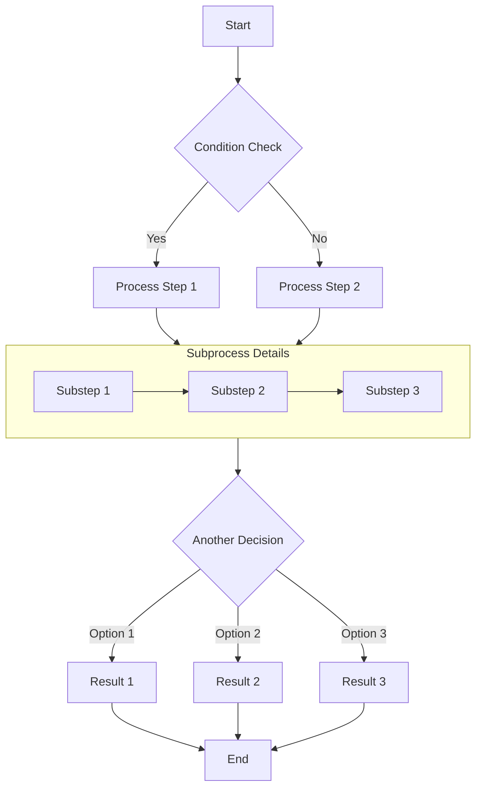
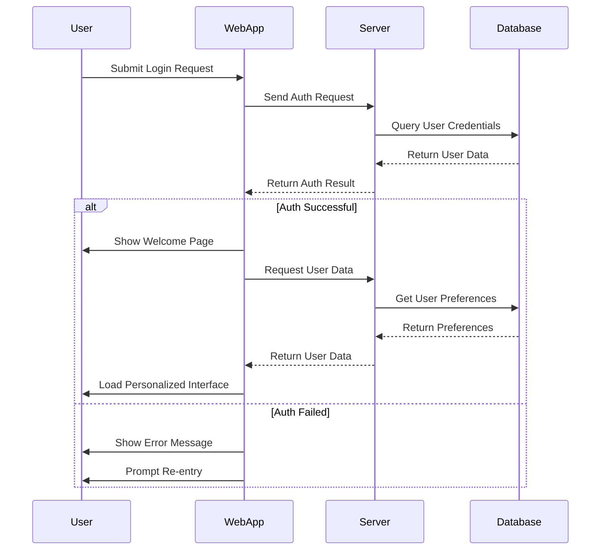
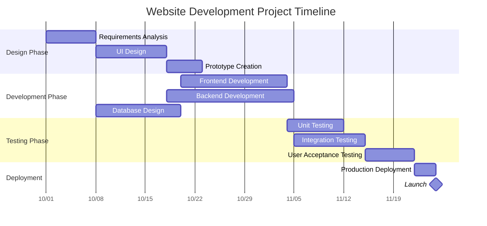
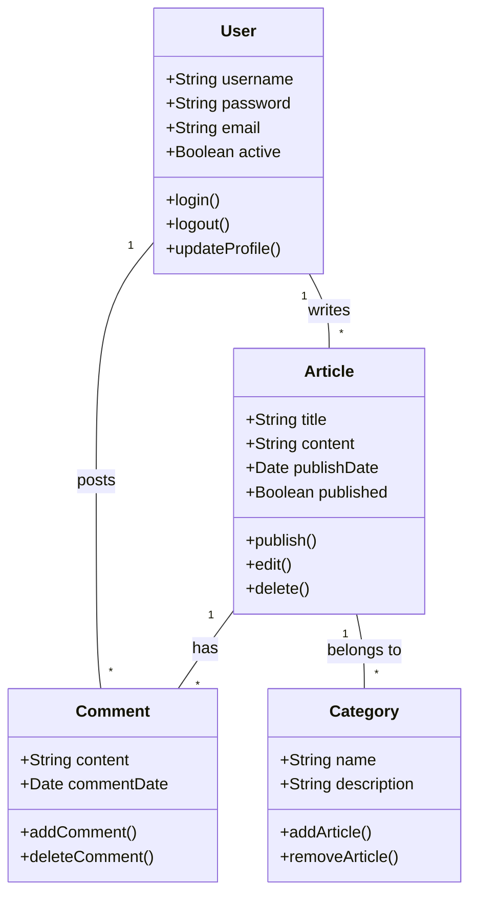
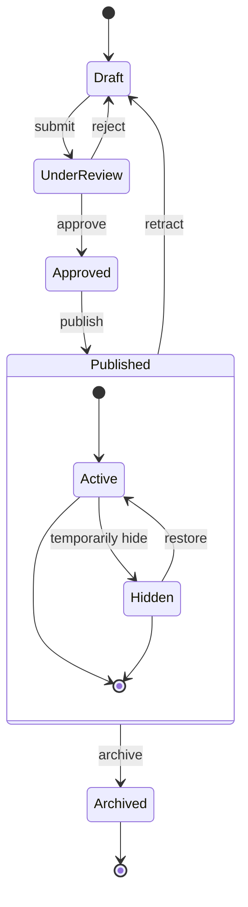
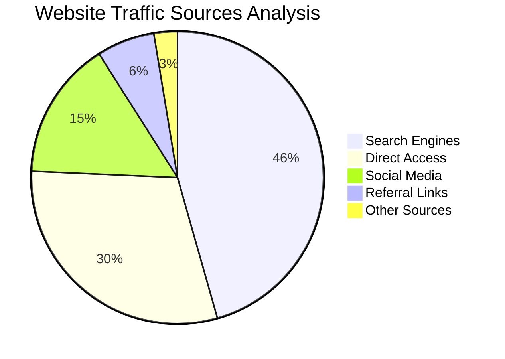

# Markdown 配合 Mermaid 绘图完全指南

本文演示如何在 Markdown 文档中用 Mermaid 画各种复杂图形，包括流程图、时序图、甘特图、类图和状态图。

## 流程图示例

流程图很适合表示流程或算法步骤。

## 时序图示例

时序图展示对象之间随时间发生的交互。

## 甘特图示例

甘特图很适合展示项目排期和时间线。

## 类图示例

类图展示系统的静态结构，包括类、属性、方法以及它们之间的关系。

## 状态图示例

状态图展示一个对象在生命周期里经历的状态序列。

## 饼图示例

饼图适合展示占比和百分比数据。

## 小结

Mermaid 是在 Markdown 文档里画各类图表的强力工具。本文演示了流程图、时序图、甘特图、类图、状态图和饼图。这些图能帮你更清楚地表达复杂的概念、流程和数据结构。

用 Mermaid 的方法很简单：在代码块里标注 `mermaid` 语言，然后用简洁的文本语法描述图形，Mermaid 会自动把它渲染成图。

下一篇文章或者项目文档里可以试试用 Mermaid，内容会更容易看懂。
